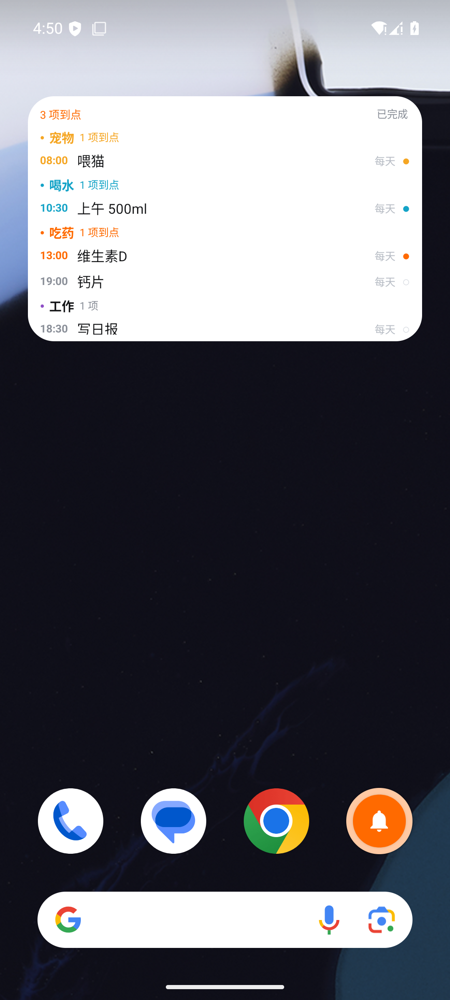
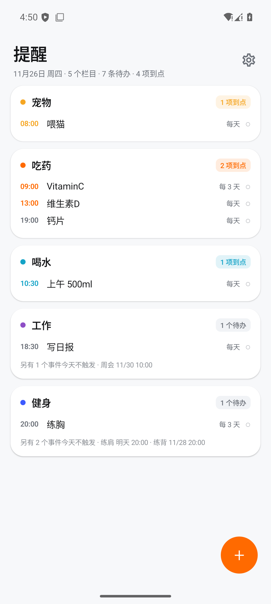
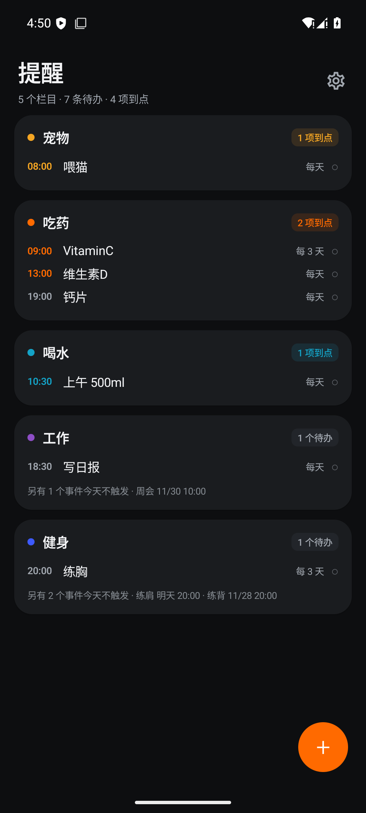

# 提醒 · RemindWidget

**把「每天要做的几件事」摆在桌面上的 Android 提醒 App。**

4×2 桌面小组件 · 左侧选栏目 · 右侧看时间 · 点一下即完成

[**⬇ 下载最新版**](../../releases/latest) ｜ [更新日志](CHANGELOG.md) ｜ [反馈问题](../../issues)

<p align="center">
  
  
  
</p>

---

## 下载安装

1. 打开 [Releases 页面](../../releases/latest)，下载最新的 `RemindWidget-vX.Y.Z.apk`
2. 手机上点安装，允许「安装未知来源应用」
3. 打开 App，**第一次会弹通知权限，务必允许**
4. 进「设置」页，把前两项开成「已开启」：**通知权限** 和 **精确闹钟**
5. 按设置页里显示的步骤把小部件加到桌面（见下文）

**系统要求**：Android 8.0（API 26）及以上。已在小米 17 / HyperOS 4.0（Android 17）真机验证。

> 从旧版升级直接覆盖安装即可，**数据不会丢**（数据库带迁移）。
> 装好之后就不用再手动传 APK 了——App 里点「检查更新」能直接从 GitHub 下载安装。

### 怎么把小组件加到桌面

**小米 / Redmi（HyperOS、MIUI）** —— 入口藏得比较深，按这个顺序：

```
桌面空白处【双指捏合】→ 底部【小部件】→【全部应用】
→ 滚到列表最底部点【安卓小部件】 → 再滚到最底找到【提醒】→ 双击
```

> ⚠️ 小部件面板顶部的搜索框**搜不到本应用**——HyperOS 只搜小米自家组件，
> 标准 Android 组件不在这套索引里，必须从「安卓小部件」分类进去找。

**其他品牌**（设置页会自动识别机型并显示对应步骤）：

| 品牌 | 路径 |
|---|---|
| 三星 One UI | 长按桌面 → 小组件 → 找到「提醒」→ 拖动 |
| OPPO / 一加 / realme | 长按桌面 → 小部件 / 卡片 → 找到「提醒」 |
| vivo / iQOO | 长按桌面 → 原子组件 / 小部件 → 找到「提醒」 |
| 华为 / 荣耀 | 长按桌面 → 服务卡片 / 小组件（部分鸿蒙机型对标准 Android 组件支持有限） |
| 原生 / 其他 | 长按桌面 → 小部件 / Widgets → 找到「提醒」 |

**注意**：App 里的「尝试一键添加」用的是系统的 `requestPinAppWidget` 接口。
小米 HyperOS 4.0 上这个接口是**假的**——会返回成功，但系统什么都不做。所以那个按钮只作为尝试，
**手动路径永远可用**。

---

## 长什么样

```
┌────────────────────────────────┐
│ 2 项到点 · 吃药  ✓2            │  ← 顶部：全局到点数 · 当前栏目 · 今日已处理
├──────┬─────────────────────────┤
│●宠物 │ ✓ 1̶3̶:̶0̶0̶ ̶维̶生�ṡD̶        ↺ │  ← 已完成：灰色 + 删除线
│ 喝水 │ ✓ 1̶9̶:̶0̶0̶ ̶钙̶片̶          ↺ │
│┃吃药 │ 20:00  维生素E        ⊘ │  ← 待办：点整行=完成，点⊘=忽略
│ 工作 │ ⊘ 08:00 喂猫          ↺ │  ← 已忽略：灰色 ⊘，不划删除线
└──────┴─────────────────────────┘
```

- **左 76dp**：栏目列表，点击切换。有到点未处理项的栏目，名字右侧带同色小圆点
- **右侧**：当前栏目的时间项。待办在前，完成 / 忽略的沉到底部变灰
- **三个动作互不干扰**：点整行 = 完成，点 `⊘` = 忽略，点 `↺` = 撤销回待办

---

## 功能

- **4×2 桌面小组件**：左右分栏、栏目切换、到点自动置顶、完成/忽略/撤销全在桌面完成
- **四种重复方式**：仅一次 / 每天 / 每周指定星期 / 间隔 N 天（固定锚点）
- **精确闹钟**：`AlarmManager.setExactAndAllowWhileIdle`，不是 WorkManager 轮询
- **通知可直接完成**：通知横幅上带「完成」按钮，不用进 App
- **开机自愈**：开机 / 改时间 / 改时区 / 应用更新后自动重建全部闹钟
- **深浅色跟随系统**：App 和小组件都适配
- **应用内更新**：读本仓库 Release，一键下载并拉起安装器

### 「间隔 N 天」是固定锚点

选「间隔 3 天」并指定锚点日（默认今天），就固定在第 3、6、9… 天触发。
**提前做完不会把周期往前推**——健身计划需要的是固定节奏，不是"刷完就刷新"。

举例：练胸锚点 = 今天−3 天、练肩 = 今天−2 天、练背 = 今天−1 天，间隔都是 3 天，
那么今天只有「练胸」出现在待办里，另外两个在首页会标成「练肩 明天 20:00 · 练背 11/28 20:00」。

---

## 权限说明

| 权限 | 用途 | 不给会怎样 |
|---|---|---|
| 通知 | 到点弹提醒 | 只在小组件里看得到，不弹通知 |
| 精确闹钟 | 准点触发 | 系统会把它推迟（13:00 的提醒可能 13:15 才响） |
| 省电策略：无限制 | 后台不被冻结 | 长时间不打开 App 可能收不到 |
| 自启动（小米） | 重启后能自启 | 重启后闹钟可能不恢复 |

设置页会**实时显示前两项的真实状态**；「自启动」在小米上标注为「需手动确认」，
因为那个开关在私有 AppOps 里，第三方 App 读不到——不是不想读，是系统不允许。

---

## 从源码构建

要求：**JDK 17**、**Android SDK（compileSdk 35）**、**Gradle 8.11**。

```bash
# local.properties 里写自己的 SDK 路径
echo "sdk.dir=/path/to/Android/sdk" > local.properties

./gradlew assembleDebug          # 产物在 app/build/outputs/apk/debug/
```

Windows 上也可以用仓库里的脚本：

```powershell
.\dev-tools\build.ps1            # 构建（增量约 3-8 秒）
.\dev-tools\install.ps1 -grant   # 装到已连接设备并授予通知权限
.\dev-tools\shot.ps1 名字        # 截当前屏幕到 dev-tools\shots\
.\dev-tools\ui.ps1 -tap "设置"   # 按文本定位并点击（adb 调试用）
```

> ⚠️ **工程路径不能含中文**，AGP 会直接拒绝构建（`Your project path contains non-ASCII characters`）。

---

## 项目结构

```
app/src/main/java/com/remind/widget/
├── core/Schedule.kt          调度纯函数：哪天触发 / 下次何时 / 今天是否到点
├── core/DayPlan.kt           "今天该怎么办"：排序规则，App 与小组件共用
├── core/AlarmScheduler.kt    精确闹钟：排定 / 取消 / 全量重建 / 自测
├── core/Notifier.kt          通知渠道与内容
├── core/UpdateChecker.kt     GitHub Release 检查 + 下载 + 拉起安装器
├── data/                     Room：Group / Event / DoneRecord + Repository（唯一写入口）
├── widget/                   AppWidgetProvider + RemoteViewsFactory + 渲染
├── receiver/                 闹钟 / 开机 / 小组件点击
└── ui/                       Compose：首页 / 编辑 / 事件定时 / 设置
```

改动调度语义只需要看 `Schedule.kt` 和 `DayPlan.kt` 两个文件。

主要技术栈：Kotlin 2.0 / Jetpack Compose / Room / RemoteViews（**没用 Glance**，
因为 Glance 的 LazyColumn 在桌面上只是"半可交互快照"，做不出稳定的纵向滚动）。

发版流程：

```powershell
# 1. 改 app/build.gradle.kts 的 versionCode / versionName
.\dev-tools\build.ps1
Copy-Item app\build\outputs\apk\debug\app-debug.apk .\RemindWidget-v1.x.x.apk
gh release create v1.x.x .\RemindWidget-v1.x.x.apk --title "v1.x.x" --notes "改了什么"
```

App 只认 `releases/latest`，不需要改代码。

---

## 已知限制

- **小组件翻页是点左上角的栏目，不是横滑**。Android 15 起 RemoteViews 白名单移除了
  `HorizontalScrollView`，桌面组件也收不到 `onTouch`，滑动翻页在平台层走不通。
- **小米上「一键添加」不可用**（见上文），必须手动添加。
- 4×2 只放得下约 4-5 行，栏目多时右侧需要滚动。
- 部分鸿蒙机型对标准 Android AppWidget 支持有限。
- 没有云同步 / 备份。

## License

[MIT](LICENSE) © LanFeng97
